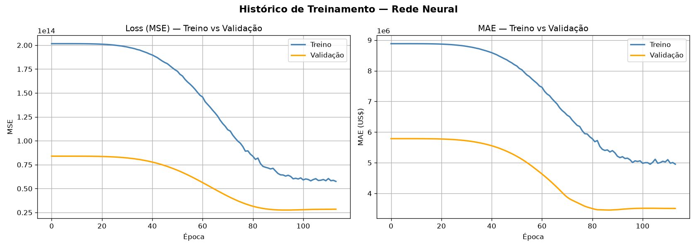
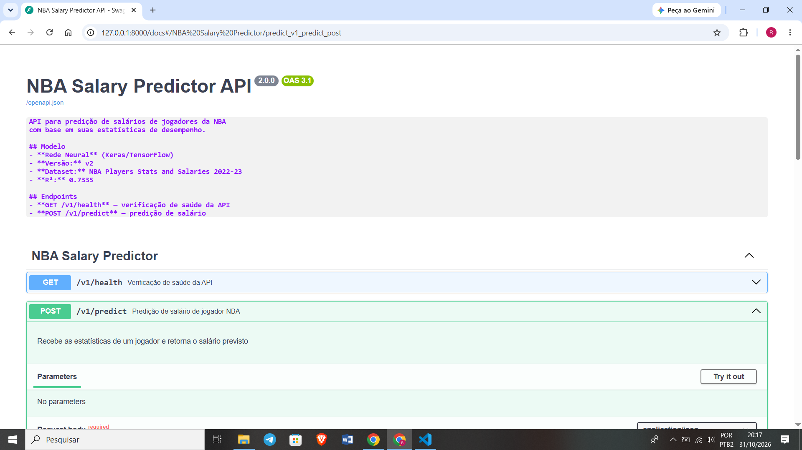
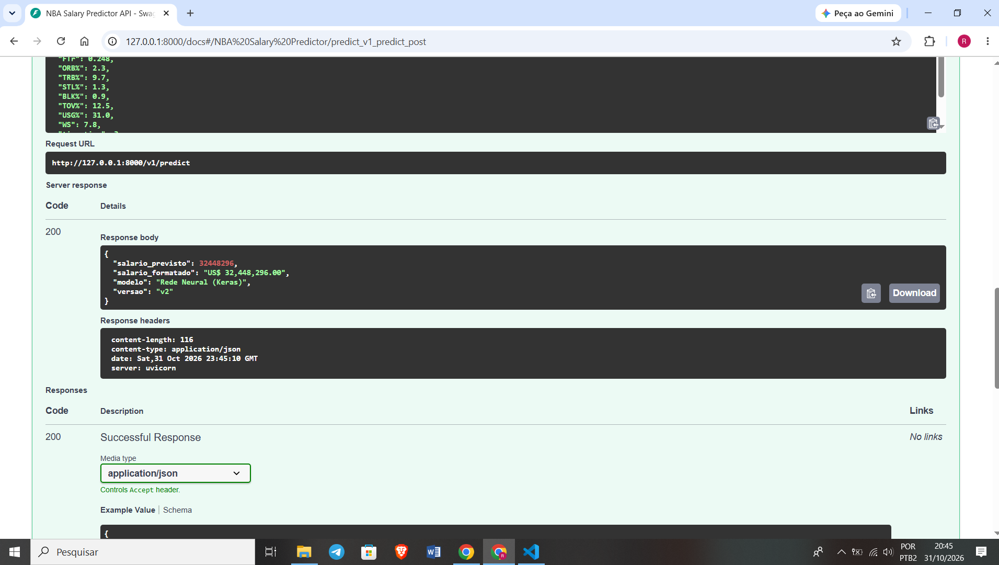
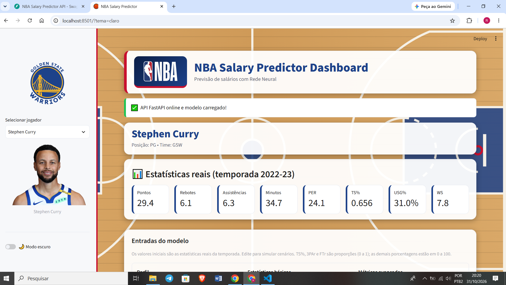
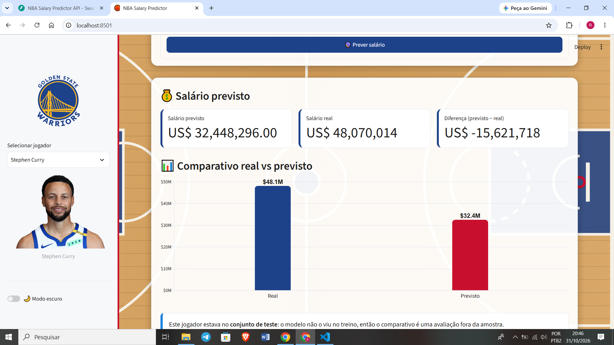

# 🏀 NBA Salary API

API REST que prevê o **salário anual de jogadores da NBA** a partir das estatísticas da temporada 2022-23, usando uma **Rede Neural (Keras)**. O projeto inclui o pipeline de treinamento, a API em **FastAPI** e um **dashboard interativo em Streamlit**.

> Projeto Avaliativo Final do Módulo 2 — Desenvolvimento de IA para Análise Preditiva - SCTEC

## 🎥 Vídeo de demonstração

[**Assistir ao vídeo (Google Drive)**](https://drive.google.com/file/d/1D2X_Mji45kivEz1HwMD2yeE_3Z4NXMSx/view?usp=drive_link)

---

## 📌 Problema de negócio

Times precisam decidir contratações e renovações, e agentes negociam contratos. Um modelo que estima o salário "esperado" a partir do desempenho em quadra ajuda a identificar jogadores **sub ou supervalorizados**.

- **Variável alvo:** `Salary` (salário anual em US$, valor numérico contínuo)
- **Tipo de problema:** regressão

---

## 🧠 Origem do modelo e do dataset

**Opção B (desenvolvimento próprio), com evolução de um projeto anterior.**

- **Dataset:** *NBA Player Salaries (2022-23 Season)*, do Kaggle — 467 jogadores, 52 colunas originais (`data/nba_2022-23_all_stats_with_salary.csv`).
- **Origem:** o pré-processamento e o dataset vêm do projeto do Módulo 1, o [NBA Salary Predictor](https://github.com/rodrigo-seibt/Nba-Salary-Predictor), que usava Regressão Linear (R² ≈ 0,69). Neste projeto o modelo evolui para uma **Rede Neural** e é colocado em produção como API.
- **Treinamento:** notebook em `notebooks/nba_neural_network.ipynb`.

### Pipeline de dados (resumo)

| Etapa | O que foi feito |
|---|---|
| Limpeza | Remoção de colunas de identificação, de baixa correlação e redundantes; posição e time combinados (`PG-SG`, `LAL/LAC`) simplificados para o primeiro valor |
| Feature engineering | `eficiencia` (PTS + AST + TRB + STL + BLK) e `tier_time` (3 faixas de poder financeiro da franquia) |
| Encoding | Label Encoding em `Position` |
| Multicolinearidade | Remoção de colunas com correlação > 0,85 (MP, 2P, FT, TOV, FG, DRB%, OWS, DWS, AST%, VORP) |
| Valores ausentes | `SimpleImputer` com **mediana** |
| Escalonamento | `StandardScaler`, ajustado só no treino (sem data leakage) |
| Divisão | 80% treino / 20% teste (94 jogadores); 20% do treino como validação |
| Outliers | **Mantidos**: são jogadores reais, e a API recebe estatísticas reais sem winsorização |

---

## 📊 Resultados

Os três modelos usam o **mesmo pré-processamento e o mesmo split**. Métricas no conjunto de teste (94 jogadores nunca vistos):

| Modelo | MAE | RMSE | R² |
|---|---|---|---|
| Regressão Linear | US$ 4,69M | US$ 6,18M | 0,7119 |
| KNN (K=10) | US$ 3,95M | US$ 5,79M | 0,7471 |
| **Rede Neural (modelo da API)** | US$ 3,97M | US$ 5,95M | 0,7335 |

Métricas completas, data de treinamento, versões das bibliotecas e lista de variáveis: [`models/metricas_v2.json`](models/metricas_v2.json).

### Por que a API usa a Rede Neural?

O KNN (K=10) obteve o menor RMSE. A diferença para a Rede Neural é pequena diante de apenas 94 amostras de teste, e o K do KNN foi escolhido olhando o próprio conjunto de teste, o que favorece esse modelo. A Rede Neural foi mantida por ser o objetivo do projeto, por guardar só os pesos (o KNN precisa guardar todo o conjunto de treino) e por permitir evolução com mais dados. É uma **decisão de projeto**, e não prova de superioridade neste dataset pequeno.

### Arquitetura da Rede Neural

`24 features → Dense(128, ReLU) → Dropout(0,2) → Dense(64, ReLU) → Dropout(0,2) → Dense(32, ReLU) → Dense(1, linear)`

Otimizador Adam, loss MSE, `EarlyStopping` e `ReduceLROnPlateau`.



*Curvas de aprendizado: a loss (MSE) e o MAE de treino e validação ao longo das épocas.*

---

## 🛠️ Tecnologias utilizadas

- **Python** 3.13
- **API:** FastAPI, Pydantic, Uvicorn
- **Machine Learning:** TensorFlow/Keras, scikit-learn, pandas, NumPy, joblib
- **Dashboard:** Streamlit, Altair, nba_api, requests
- **Versionamento:** Git/GitHub (Git Flow)

| Biblioteca | Versão |
|---|---|
| fastapi | 0.150.0 |
| pydantic | 2.14.1 |
| uvicorn | 0.54.0 |
| tensorflow | 2.21.0 |
| scikit-learn | 1.9.1 |
| pandas | 3.0.6 |
| numpy | 2.5.4|
| streamlit | 1.66.1 |

> Todas as dependências, com versões exatas, estão em [`requirements.txt`](requirements.txt).

---

## 🚀 Instalação e execução

### 1. Clonar e criar o ambiente virtual

```bash
git clone https://github.com/rodrigo-seibt/Nba-Salary-API.git
cd Nba-Salary-Api

python -m venv venv

# Windows (Git Bash)
source venv/Scripts/activate
# Windows (PowerShell): .\venv\Scripts\Activate.ps1
# Linux/Mac: source venv/bin/activate

pip install -r requirements.txt
```

### 2. Iniciar a API

```bash
python -m uvicorn main:app --reload
```

- API: http://127.0.0.1:8000
- **Documentação Swagger:** http://127.0.0.1:8000/docs

### 3. Iniciar o dashboard (em outro terminal, com o venv ativo)

```bash
streamlit run app.py
```

- Dashboard: http://localhost:8501 (a API precisa estar rodando)

### 4. (Opcional) Regenerar os dados ou o modelo

```bash
python preparar_dados.py   # gera data/nba_dashboard.csv
```

Para retreinar o modelo, execute `notebooks/nba_neural_network.ipynb` com o kernel do `venv`. Ele regrava os arquivos em `models/`.

---

## 📡 Documentação da API

| Método | Rota | Descrição |
|---|---|---|
| GET | `/` | Informações básicas da API |
| GET | `/v1/health` | Status do serviço e se o modelo está na memória |
| POST | `/v1/predict` | Previsão do salário de um jogador |

Documentação interativa: **http://127.0.0.1:8000/docs**

### Visão geral dos endpoints


### Exemplo de predição (200 OK)


### `GET /v1/health`

```json
{
  "status": "online",
  "modelo_carregado": true,
  "versao": "v2"
}
```

### `POST /v1/predict`

**Exemplo de requisição** (estatísticas do Stephen Curry, 2022-23):

```json
{
  "Position": "PG",
  "Age": 34,
  "GP": 56,
  "GS": 56,
  "3P": 4.9,
  "TRB": 6.1,
  "AST": 6.3,
  "STL": 0.9,
  "BLK": 0.4,
  "PF": 2.1,
  "PTS": 29.4,
  "PER": 24.1,
  "TS%": 0.656,
  "3PAr": 0.564,
  "FTr": 0.248,
  "ORB%": 2.3,
  "TRB%": 9.7,
  "STL%": 1.3,
  "BLK%": 0.9,
  "TOV%": 12.5,
  "USG%": 31.0,
  "WS": 7.8,
  "tier_time": 3,
  "eficiencia": 43.1
}
```

**Exemplo de resposta (200 OK):**

```json
	
Response body
Download
{
  "salario_previsto": 32448296,
  "salario_formatado": "US$ 32,448,296.00",
  "modelo": "Rede Neural (Keras)",
  "versao": "v2"
}
```

> O valor previsto muda levemente a cada versão treinada do modelo.

**Chamada com curl:**

```bash
curl -X POST "http://127.0.0.1:8000/v1/predict" \
  -H "Content-Type: application/json" \
  -d @payload.json
```

### Códigos HTTP

| Código | Quando ocorre |
|---|---|
| **200 OK** | Predição realizada (ou serviço saudável no `/health`) |
| **400 Bad Request** | Dado válido no formato, mas inconsistente com uma regra de negócio (ex.: `GS` maior que `GP`). Barrado na camada de serviço |
| **422 Unprocessable Entity** | Dados inválidos: tipo incorreto, campo ausente ou valor fora dos limites. Barrado pelo Pydantic **antes** de chegar ao modelo |
| **500 Internal Server Error** | Erro inesperado durante a inferência, devolvido com mensagem tratada |
| **503 Service Unavailable** | `/health` quando o modelo não está carregado na memória |

**Exemplo de erro 422** (idade fora do limite, resposta resumida):

**Exemplo de erro 400** (`GS` maior que `GP`):

```json
{
  "detail": "GS (jogos como titular = 50) não pode ser maior que GP (jogos disputados = 10)."
}
```

> **422 × 400:** o 422 indica formato inválido (tipo errado, campo ausente ou fora do limite), validado pelo Pydantic campo a campo. O 400 indica que cada campo é válido sozinho, mas a combinação é impossível.

```json
{
  "detail": [
    {
      "type": "less_than_equal",
      "loc": ["body", "Age"],
      "msg": "Input should be less than or equal to 45",
      "input": 60
    }
  ]
}
```

> Os campos `3P`, `TS%`, `3PAr`, `ORB%`, `TRB%`, `STL%`, `BLK%`, `TOV%` e `USG%` usam esses nomes exatos no JSON (via `alias` do Pydantic).

---

## 🖥️ Dashboard (Streamlit)

O dashboard consome a API: o usuário escolhe um jogador, vê a foto e as estatísticas reais, edita os valores para simular cenários e compara o **salário previsto** com o **salário real**. Para jogadores do conjunto de teste, o comparativo é uma avaliação fora da amostra.

### Seleção do jogador


### Resultado da previsão


---

## 🏗️ Arquitetura

Estrutura em camadas, sem regras do modelo dentro das rotas:

```
Requisição HTTP
      ↓
routers/predict.py   → recebe a requisição, trata erros HTTP
      ↓
schemas/player.py    → valida entrada e saída (Pydantic)
      ↓
services/model_service.py → pré-processamento e inferência
      ↓
Modelo em memória (carregado uma única vez no lifespan)
```

- **Lifespan:** o modelo, o pipeline e o LabelEncoder são carregados na RAM **uma única vez**, na inicialização (`@asynccontextmanager` em `main.py`). Nenhum arquivo é lido do disco a cada requisição.
- **Validação estrita:** `Field` com `ge`, `le` e `Literal` define os limites de cada variável.
- **Regra de negócio:** `GS ≤ GP` é validada na camada de serviço, que lança `RegraDeNegocioError`. O roteador traduz esse erro para o status 400, mantendo as regras do domínio fora do protocolo HTTP.
- **Pré-processamento na inferência:** a API aplica o mesmo LabelEncoder e o `StandardScaler` do treino. O `SimpleImputer` do pipeline não é usado na inferência, pois o Pydantic já garante que não há valores ausentes.

### Estrutura do repositório

```
nba-salary-api/
├── main.py                    # entrada da API, lifespan e roteadores
├── routers/predict.py         # endpoints /v1/health e /v1/predict
├── schemas/player.py          # modelos Pydantic de entrada e saída
├── services/model_service.py  # carregamento do modelo e inferência
├── app.py                     # dashboard Streamlit
├── visual.py                  # visual do dashboard
├── preparar_dados.py          # gera o CSV do dashboard
├── models/
│   ├── modelo_rn_v2.keras     # Rede Neural treinada
│   ├── pipeline_scaler.pkl    # imputer + scaler
│   ├── label_encoder.pkl      # encoder das posições
│   └── metricas_v2.json       # métricas e metadados
├── notebooks/nba_neural_network.ipynb
├── data/                      # dataset original e dados do dashboard
├── outputs/                   # gráficos gerados no treinamento
├── assets/  .streamlit/       # recursos do dashboard
├── requirements.txt
├── LICENSE
└── README.md
```

---

## 🌿 Organização e Git Flow

O desenvolvimento seguiu o Git Flow, com uma branch por tarefa e Pull Requests para a `develop`. Nenhuma branch foi apagada após o merge.

| Branch | Objetivo |
|---|---|
| `main` | Versão final |
| `develop` | Integração das features |
| `feature/modelo` | Modelo serializado e notebook de treinamento |
| `feature/schemas` | Validação Pydantic |
| `feature/services` | Carregamento e inferência |
| `feature/routers` | Endpoints FastAPI |
| `feature/main` | Ponto de entrada e lifespan |
| `feature/streamlit` | Dashboard interativo |
| `fix/metricas-notebook` | Correção do comparativo de modelos e das métricas |
| `chore/requirements` | Atualização das dependências |
| `feature/docs` | README |
| `fix/schema-limites` | Ajuste dos limites do schema para cobrir jogadores reais |
| `feature/validacao-negocio` | Regra de negócio `GS ≤ GP` com resposta 400 |
| `docs/link-video` | Inclusão do link do vídeo no README |
| `docs/readme-erro-400` | Inclusão do erro 400 e regra de negócio no README |

---

## ⚠️ Limitações

- Dataset pequeno (467 jogadores, uma temporada): as métricas variam entre execuções.
- O `tier_time` usa o salário médio por time calculado com todos os jogadores, inclusive os de teste, o que gera um pequeno vazamento de informação do alvo.
- Fatores como popularidade, marketing e histórico de lesões não estão no dataset.
- As fotos do dashboard vêm da CDN pública da NBA e exigem internet.

## 🔮 Melhorias para versões futuras (v3)

- Escolher o K do KNN com validação cruzada, e não pelo conjunto de teste.
- Calcular o `tier_time` apenas com o conjunto de treino.
- Calcular `eficiencia` dentro da API, em vez de exigi-la no payload.
- Testar Random Forest e Gradient Boosting; ajustar hiperparâmetros da Rede Neural.
- Incluir mais temporadas para capturar tendências.
- Containerizar com Docker e adicionar testes automatizados da API.

---

## 📄 Licença

Distribuído sob a licença MIT. Veja o arquivo [LICENSE](LICENSE).

---

## 👤 Autor

**RODRIGO SEIBT**

- GitHub: [@rodrigo-seibt](https://github.com/rodrigo-seibt)
- LinkedIn: [Rodrigo Seibt](https://www.linkedin.com/in/rodrigo-seibt01/)

Projeto desenvolvido como Projeto Avaliativo Final do Módulo 2 do curso **Desenvolvedor(a) em IA para Análise Preditiva**.
